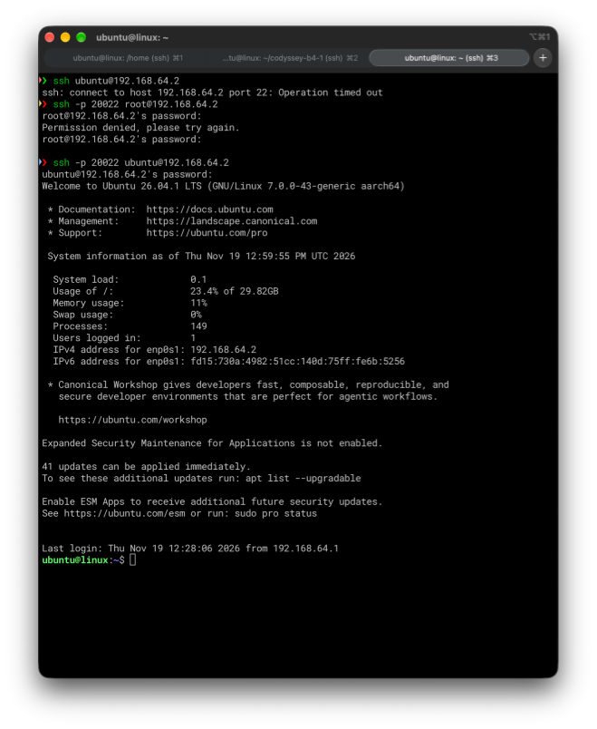
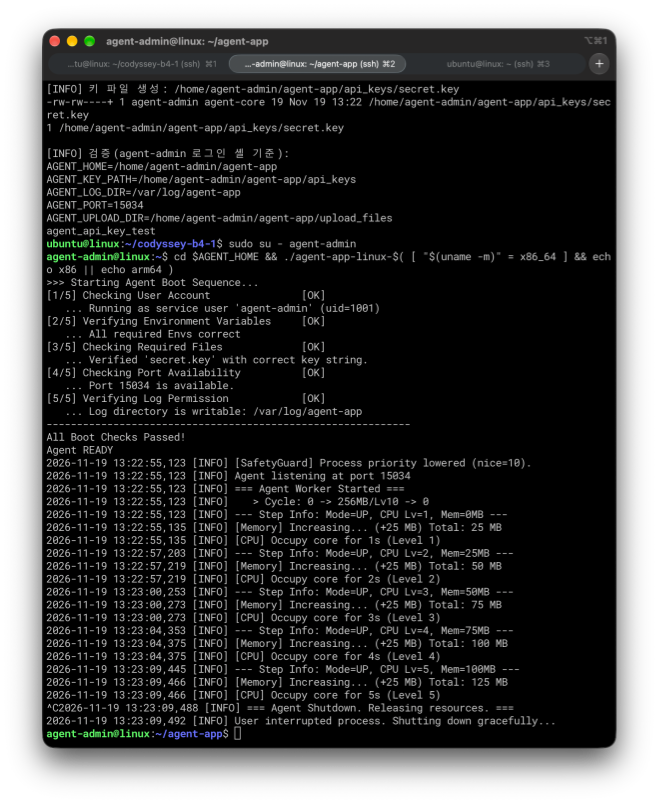
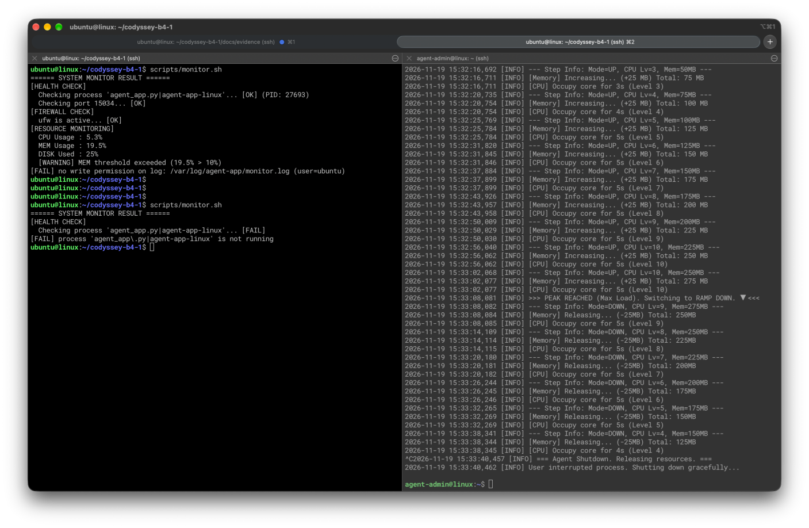

# B4-1 요구사항 수행 내역서 — 컴퓨터가 알아서 자기 상태를 점검하게 만들기

| 항목 | 내용 |
|---|---|
| 수행자 | `최진석` |
| 수행 기간 | `2026-11-19 ~ 2026-11-20` |
| 실습 환경 | Ubuntu 26.04.1 LTS (live server) / UTM VM / arm64 (`uname -m` = aarch64), VM IP `192.168.64.2` |
| 방화벽 선택 | **UFW** |
| 제출물 | 본 문서 + `scripts/monitor.sh` (보너스: `scripts/report.sh`, `scripts/log_retention.sh`) |

모든 증빙 원본은 `docs/evidence/` 의 텍스트 파일이고, 아래 코드 블록은 그 발췌다. 터미널 캡처 이미지(`docs/screenshots/`)는 같은 내용을 보조로 보여 준다.

---

## 0. 구성 요약

| 항목 | 값 |
|---|---|
| SSH | 포트 `20022`, `PermitRootLogin no` |
| 방화벽 | UFW active, default deny incoming, allow `20022/tcp`, `15034/tcp` |
| 계정 | `agent-admin`(운영·cron), `agent-dev`(monitor.sh 작성), `agent-test`(QA) |
| 그룹 | `agent-common`(admin, dev, test) / `agent-core`(admin, dev) |
| AGENT_HOME | `/home/agent-admin/agent-app` |
| 디렉토리 | `upload_files`(common rwx) · `api_keys`(core only) · `/var/log/agent-app`(core only) · `bin`(dev 소유, core 실행) |
| 환경 변수 | `/etc/profile.d/agent-env.sh` (AGENT_HOME, AGENT_PORT, AGENT_UPLOAD_DIR, AGENT_KEY_PATH, AGENT_LOG_DIR). `AGENT_KEY_PATH` 는 키 디렉토리 `$AGENT_HOME/api_keys`, 키 파일은 그 안의 `secret.key` (제공 앱 동작 기준) |
| 앱 | `agent-app-linux-arm64` 를 agent-admin(uid 1001)으로 실행, `0.0.0.0:15034` LISTEN |
| monitor.sh | `$AGENT_HOME/bin/monitor.sh`, `agent-dev:agent-core 750` |
| cron | agent-admin: monitor.sh `* * * * *`, log_retention.sh `0 3 * * *` |
| 로그 용량 관리 | monitor.sh 내부 크기 기반 회전 (10MB / 총 10개). logrotate 미사용 — 이유는 [9-1](#9-1-로그-용량-관리-방식-선택--logrotate-대신-스크립트) |

---

## 1. 기본 보안 및 네트워크 설정

### 1-1. SSH 포트 변경 및 Root 원격 접속 차단
**수행 명령**
```bash
sudo cp -a /etc/ssh/sshd_config /etc/ssh/sshd_config.bak.$(date +%F)
sudo sed -i -E 's/^[#[:space:]]*Port[[:space:]].*/Port 20022/' /etc/ssh/sshd_config
sudo sed -i -E 's/^[#[:space:]]*PermitRootLogin[[:space:]].*/PermitRootLogin no/' /etc/ssh/sshd_config
sudo sshd -t && sudo systemctl restart ssh
```
**확인 내역** ([`01-sshd-config.txt`](evidence/01-sshd-config.txt), [`02-sshd-listen.txt`](evidence/02-sshd-listen.txt))
```
$ grep -nE '^(Port|PermitRootLogin)' /etc/ssh/sshd_config
35:Port 20022
54:PermitRootLogin no
$ sudo sshd -T | grep -Ei '^(port|permitrootlogin) '      # 유효(effective) 설정
port 20022
permitrootlogin no
$ ss -tulnp | grep sshd
LISTEN 0  4096   0.0.0.0:20022   0.0.0.0:*   users:(("sshd",pid=11455,fd=3),("systemd",pid=1,fd=78))
LISTEN 0  4096      [::]:20022      [::]:*   users:(("sshd",pid=11455,fd=4),("systemd",pid=1,fd=79))
```
**원격 접속 검증 — 호스트(macOS)의 다른 터미널에서** ([`03a-root-denied.txt`](evidence/03a-root-denied.txt))
```
❯ ssh ubuntu@192.168.64.2
ssh: connect to host 192.168.64.2 port 22: Operation timed out        ← 22 차단
❯ ssh -p 20022 ubuntu@192.168.64.2
Welcome to Ubuntu 26.04.1 LTS (GNU/Linux 7.0.0-43-generic aarch64)   ← 일반 계정 20022 접속 성공
❯ ssh -p 20022 root@192.168.64.2
root@192.168.64.2's password:
Permission denied, please try again.                                  ← root 거부
```


### 1-2. 방화벽(UFW) 활성화 및 20022/tcp, 15034/tcp 만 허용
**수행 명령**
```bash
sudo ufw default deny incoming && sudo ufw default allow outgoing
sudo ufw allow 20022/tcp comment 'SSH (b4-1)' && sudo ufw allow 15034/tcp comment 'Agent APP (b4-1)'
sudo ufw --force enable
```
**확인 내역** ([`03-firewall.txt`](evidence/03-firewall.txt)) — IPv4·IPv6 모두 두 포트만 허용
```
Status: active
Logging: on (low)
Default: deny (incoming), allow (outgoing), disabled (routed)

To                         Action      From
--                         ------      ----
20022/tcp                  ALLOW IN    Anywhere                   # SSH (b4-1)
15034/tcp                  ALLOW IN    Anywhere                   # Agent APP (b4-1)
20022/tcp (v6)             ALLOW IN    Anywhere (v6)              # SSH (b4-1)
15034/tcp (v6)             ALLOW IN    Anywhere (v6)              # Agent APP (b4-1)
```

### 1-3. 보안 효과와 한계 (위협 모델)

| 위협 | 대응 | 효과 | 한계 |
|---|---|---|---|
| 22번을 훑는 자동화 봇의 비밀번호 대입(브루트포스) | SSH 포트 20022 로 변경 | 무작위 스캔 봇 대부분이 서버를 찾지 못해 공격 시도와 auth.log 소음이 크게 준다 | **포트 난독화일 뿐**이다. `nmap -p-` 같은 전체 포트 스캔이면 20022 도 발견된다 |
| 모든 리눅스에 있는 `root` 계정 공격 | `PermitRootLogin no` | 공격자가 계정명부터 알아내야 하고, 뚫려도 일반 계정 권한에서 멈춘다. 관리자 작업은 sudo 로 기록이 남는다 | 일반 계정 비밀번호가 약하면 여전히 뚫린다 |
| 20022 를 찾아낸 뒤의 브루트포스 | (권장) 아래 추가 대응 | 시도 횟수 자체를 제한·차단 | — |

포트 변경과 root 차단은 "공격 표면을 줄이는" 첫 단계일 뿐이므로, 브루트포스 대응을 다음 순서로 겹쳐 쓰는 것을 권장한다.

1. **접속 빈도 제한(rate-limit)**: `sudo ufw limit 20022/tcp` — 같은 IP 가 30초 안에 6번 이상 연결하면 UFW 가 차단한다. 추가 패키지가 필요 없다.
2. **로그 기반 탐지·차단**: `fail2ban` 을 설치해 `/var/log/auth.log` 에서 인증 실패가 반복되는 IP 를 일정 시간 밴한다(예: `[sshd] port = 20022, maxretry = 5, bantime = 1h`).
3. **인증 강화**: 공개키 인증으로 전환한 뒤 `PasswordAuthentication no` 로 비밀번호 대입 자체를 불가능하게 만든다.
4. **탐지 확인**: `sudo grep 'Failed password' /var/log/auth.log | awk '{print $(NF-3)}' | sort | uniq -c | sort -rn | head` 로 공격 IP 를 주기적으로 본다.

---

## 2. 계정/그룹/권한 체계

### 2-1. 계정 및 그룹 생성
**수행 명령**
```bash
sudo groupadd agent-common; sudo groupadd agent-core
for u in agent-admin agent-dev agent-test; do sudo useradd -m -s /bin/bash $u; done
sudo usermod -aG agent-common,agent-core agent-admin
sudo usermod -aG agent-common,agent-core agent-dev
sudo usermod -aG agent-common agent-test
```
**확인 내역** ([`04-users-groups.txt`](evidence/04-users-groups.txt))
```
uid=1001(agent-admin) gid=1003(agent-admin) groups=1003(agent-admin),1001(agent-common),1002(agent-core)
uid=1002(agent-dev) gid=1004(agent-dev) groups=1004(agent-dev),1001(agent-common),1002(agent-core)
uid=1003(agent-test) gid=1005(agent-test) groups=1005(agent-test),1001(agent-common)
agent-common:x:1001:agent-admin,agent-dev,agent-test
agent-core:x:1002:agent-admin,agent-dev
```

| 계정 | 역할 | 로그인 셸 | 소속 그룹 | 할 수 있는 일 |
|---|---|---|---|---|
| agent-admin | 운영 | `/bin/bash` | common, core | 앱 실행, monitor.sh **실행**, cron 소유, 로그 쓰기 |
| agent-dev | 개발 | `/bin/bash` | common, core | monitor.sh **소유·수정**, 키·로그 읽기 |
| agent-test | QA | `/bin/bash` | common | upload_files 읽기·쓰기만 |

### 2-2. 디렉토리 구조 및 권한(ACL)
**수행 명령**
```bash
sudo install -d -o agent-admin -g agent-core   -m 750  /home/agent-admin/agent-app
sudo setfacl -m g:agent-common:--x /home/agent-admin /home/agent-admin/agent-app
sudo install -d -o agent-admin -g agent-common -m 2770 /home/agent-admin/agent-app/upload_files
sudo setfacl -m g:agent-common:rwx -m o::--- -d -m g:agent-common:rwx -d -m o::--- /home/agent-admin/agent-app/upload_files
sudo install -d -o agent-admin -g agent-core   -m 2770 /home/agent-admin/agent-app/api_keys /var/log/agent-app
sudo setfacl -m g:agent-core:rwx -m o::--- -d -m g:agent-core:rwx -d -m o::--- /home/agent-admin/agent-app/api_keys /var/log/agent-app
sudo install -d -o agent-dev   -g agent-core   -m 750  /home/agent-admin/agent-app/bin
```
**확인 내역** ([`05-directories.txt`](evidence/05-directories.txt), [`06-acl.txt`](evidence/06-acl.txt))
```
drwxr-x---+ 5 agent-admin agent-core   4096 Nov 19 12:41 /home/agent-admin/agent-app
drwxrws---+ 2 agent-admin agent-core   4096 Nov 19 12:41 /home/agent-admin/agent-app/api_keys
drwxr-x---  2 agent-dev   agent-core   4096 Nov 19 12:41 /home/agent-admin/agent-app/bin
drwxrws---+ 2 agent-admin agent-common 4096 Nov 19 12:42 /home/agent-admin/agent-app/upload_files
drwxrws---+ 2 agent-admin agent-core   4096 Nov 19 12:42 /var/log/agent-app
drwxrws---+ 2 agent-admin agent-core   4096 Nov 19 12:43 /var/log/monitor/agent-app/archive

# file: /home/agent-admin/agent-app/api_keys          # file: /var/log/agent-app
# group: agent-core   flags: -s-                       # group: agent-core   flags: -s-
group:agent-core:rwx   other::---                      group:agent-core:rwx   other::---
default:group:agent-core:rwx   default:other::---      default:group:agent-core:rwx   default:other::---
```
setgid(`s`)와 default ACL 로 **새로 생기는 파일도 같은 그룹·권한을 자동으로 물려받는다**.

**권한 실동작 검증** ([`07-permission-test.txt`](evidence/07-permission-test.txt), [`09-keyfile.txt`](evidence/09-keyfile.txt))
| 계정 | 대상 | 기대 | 결과 |
|---|---|---|---|
| agent-test | upload_files 에 파일 생성 | 성공 | `OK` |
| agent-test | api_keys 의 키 파일 읽기 | 거부 | `Permission denied` |
| agent-test | /var/log/agent-app 목록 | 거부 | `ls: cannot open directory '/var/log/agent-app': Permission denied` |
| agent-admin | api_keys/secret.key 읽기 | 성공 | `agent_api_key_test` |
| agent-admin | /var/log/agent-app 쓰기 | 성공 | `OK` |

---

## 3. 애플리케이션 실행 환경

### 3-1. 환경 변수 ([`08-env.txt`](evidence/08-env.txt))
```
agent-admin@linux:~/agent-app$ env | grep AGENT
AGENT_UPLOAD_DIR=/home/agent-admin/agent-app/upload_files
AGENT_PORT=15034
AGENT_KEY_PATH=/home/agent-admin/agent-app/api_keys
AGENT_HOME=/home/agent-admin/agent-app
AGENT_LOG_DIR=/var/log/agent-app
```
### 3-2. 키 파일 ([`09-keyfile.txt`](evidence/09-keyfile.txt))
```
agent-admin@linux:~/agent-app$ ls -alF api_keys
drwxrws---+ 2 agent-admin agent-core 4096 Nov 19 13:22 ./
-rw-rw----+ 1 agent-admin agent-core   19 Nov 19 13:22 secret.key
-rw-rw----+ 1 agent-admin agent-core   19 Nov 19 12:50 t_secret.key
agent-admin@linux:~/agent-app$ cat ./api_keys/secret.key
agent_api_key_test
```
미션 문서의 파일명은 `t_secret.key` 이지만, 제공 앱은 `AGENT_KEY_PATH` 디렉토리 안의 `secret.key` 를 검사한다(아래 Boot `[3/5]` 의 `Verified 'secret.key'`). 그래서 두 파일을 같은 내용으로 두었다.

### 3-3. 앱 실행 — Boot Sequence 5단계 [OK] 및 Agent READY
실행 계정: `agent-admin` (uid `1001`), 실행 명령: `cd $AGENT_HOME && ./agent-app-linux-arm64` (`run-app.sh` 가 `uname -m` 으로 선택)

**Boot 출력** ([`09a-app-boot.txt`](evidence/09a-app-boot.txt))
```
+ cd /home/agent-admin/agent-app
+ uname -m
+ ./agent-app-linux-arm64
>>> Starting Agent Boot Sequence...
[1/5] Checking User Account               [OK]
   ... Running as service user 'agent-admin' (uid=1001)
[2/5] Verifying Environment Variables     [OK]
   ... All required Envs correct
[3/5] Checking Required Files             [OK]
   ... Verified 'secret.key' with correct key string.
[4/5] Checking Port Availability          [OK]
   ... Port 15034 is available.
[5/5] Verifying Log Permission            [OK]
   ... Log directory is writable: /var/log/agent-app
------------------------------------------------------------
All Boot Checks Passed!
Agent READY
2026-11-19 16:18:16,754 [INFO] [SafetyGuard] Process priority lowered (nice=10).
2026-11-19 16:18:16,754 [INFO] Agent listening at port 15034
2026-11-19 16:18:16,754 [INFO] === Agent Worker Started ===
```


**LISTEN 확인** — 앱 로그의 `Agent listening at port 15034` 와 monitor.sh 의 포트 점검(`ss -tlnH`) 결과로 확인했다([`12-monitor-run.txt`](evidence/12-monitor-run.txt)).
```
[HEALTH CHECK]
  Checking process 'agent_app.py|agent-app-linux'... [OK] (PID: 21857)
  Checking port 15034... [OK]
```

---

## 4. 시스템 관제 자동화 스크립트 monitor.sh

### 4-1. 파일 위치/소유/권한 ([`11-monitor-script.txt`](evidence/11-monitor-script.txt))
```
-rwxr-x--- 1 agent-dev agent-core  4227 Nov 19 13:34 log_retention.sh
-rwxr-x--- 1 agent-dev agent-core 10916 Nov 19 13:34 monitor.sh
-rwxr-x--- 1 agent-dev agent-core  4033 Nov 19 13:34 report.sh
```
**권한 운영 규칙: agent-dev 는 수정, agent-admin 은 실행만.** 소유자 agent-dev 는 `rwx`, 그룹 agent-core(admin 포함)는 `r-x`, 그 밖은 `---`. cron 은 [5절](#5-자동-실행cron)처럼 **agent-admin 의 crontab** 에 등록되어 있으므로, 자동 실행도 같은 "실행만 가능한" 권한으로 돈다.

### 4-2. 구현 요약
| 요구 | 구현 (함수) | 비고 |
|---|---|---|
| 프로세스 확인, 실패 시 exit 1 | `find_app_pid` → `fail` | `pgrep -f 'agent_app\.py\|agent-app-linux'` 후보 중 포트 소유 PID 우선, 자기 PID 제외 |
| 포트 15034 LISTEN, 실패 시 exit 1 | `is_port_listening` | `ss -tlnH` → netstat → `/dev/tcp` 폴백 |
| 방화벽 점검, 비활성 시 [WARNING] 만 | `firewall_check` | root 면 `ufw status`, 아니면 `systemctl is-active ufw` + ufw.conf; firewalld 지원. PATH 에 sbin 보강 |
| CPU/MEM/DISK 수집 | `cpu_usage_percent`(/proc/stat 1초 델타), `mem_usage_percent`(/proc/meminfo), `disk_usage_percent`(`df -P /`) | 외부 명령 의존 최소 |
| 임계값 경고 | `warn_if_over` | CPU>20, MEM>10, DISK>80 (초과만, 동일값은 경고 없음) |
| 로그 기록 | `append_log` | `>>` 로 누적. `[YYYY-MM-DD HH:MM:SS] PID:n CPU:x% MEM:y% DISK_USED:z%` |
| 10MB/10개 유지 | `rotate_log_if_needed` | 10MB 이상이면 `monitor.YYYYmmdd_HHMMSS.log` 로 회전, 회전본 9개까지 보존. 보조 로그도 동일 기준. `flock` 으로 동시 실행 보호 |
| 실패 추적 | `log_error_file` | Health Check 실패 사유를 `monitor.error.log` 에 별도 기록(monitor.log 포맷 보호) |

**심각도 구분**
| 수준 | 조건 | 동작 | 종료 코드 |
|---|---|---|---|
| `[FAIL]` (장애) | 프로세스 없음, 포트 미LISTEN | 사유를 monitor.error.log 에 기록, 즉시 종료 | 1 |
| `[WARNING]` (주의) | 방화벽 비활성, CPU/MEM/DISK 임계 초과 | 경고 출력 후 수집·기록 계속 | 0 |
| `[OK]` | 정상 | 기록 | 0 |

### 4-3. 실행 결과 — 정상 ([`12-monitor-run.txt`](evidence/12-monitor-run.txt))
```
$ sudo su - agent-admin -c '$AGENT_HOME/bin/monitor.sh; echo exit=$?'
====== SYSTEM MONITOR RESULT ======
[HEALTH CHECK]
  Checking process 'agent_app.py|agent-app-linux'... [OK] (PID: 21857)
  Checking port 15034... [OK]
[FIREWALL CHECK]
  ufw is active... [OK]
[RESOURCE MONITORING]
  CPU Usage : 3.1%
  MEM Usage : 21.2%
  DISK Used : 25%
  [WARNING] MEM threshold exceeded (21.2% > 10%)
[INFO] Log appended: /var/log/agent-app/monitor.log
...
exit=0
```
MEM 임계(10%)를 넘어 `[WARNING]` 이 나왔지만, 경고 항목이라 기록을 마치고 exit 0 으로 끝났다.

### 4-4. 실행 결과 — 앱 종료 시 (Health Check 실패) ([`12a-monitor-fail.txt`](evidence/12a-monitor-fail.txt))
앱을 Ctrl+C 로 종료한 뒤 실행 → `[FAIL]` 후 즉시 종료(리소스 수집·로그 기록 단계로 넘어가지 않음). 앱을 다시 띄운 뒤에는 정상으로 돌아온다.
```
$ sudo scripts/monitor.sh
====== SYSTEM MONITOR RESULT ======
[HEALTH CHECK]
  Checking process 'agent_app.py|agent-app-linux'... [FAIL]
[FAIL] process 'agent_app\.py|agent-app-linux' is not running
$ sudo scripts/monitor.sh            # 앱 재기동 후
  Checking process 'agent_app.py|agent-app-linux'... [OK] (PID: 29645)
  Checking port 15034... [OK]
```


### 4-5. monitor.log 누적 기록 ([`13-monitor-log.txt`](evidence/13-monitor-log.txt), [`14-crontab.txt`](evidence/14-crontab.txt), [`16-report.txt`](evidence/16-report.txt))
```
[2026-11-19 13:34:36] PID:21857 CPU:4.8% MEM:21.1% DISK_USED:25%
[2026-11-19 13:36:24] PID:21857 CPU:3.1% MEM:21.2% DISK_USED:25%
[2026-11-19 13:46:02] PID:21857 CPU:0.3% MEM:16.8% DISK_USED:25%
[2026-11-19 13:47:02] PID:21857 CPU:5.3% MEM:24.1% DISK_USED:25%
[2026-11-19 13:48:02] PID:21857 CPU:4.6% MEM:19.5% DISK_USED:25%
...
[2026-11-19 15:27:02] PID:21857 CPU:7.0% MEM:20.7% DISK_USED:25%
[2026-11-19 15:28:02] PID:21857 CPU:2.0% MEM:22.4% DISK_USED:25%
[2026-11-19 15:33:03] PID:27694 CPU:4.0% MEM:23.5% DISK_USED:25%
```
약 2시간 동안 106줄이 같은 포맷으로 누적되었다(`report.sh` 의 `Data Points: 106 samples`). 앱을 재시작한 15:33 부터 PID 가 바뀐 것도 기록된다.

---

## 5. 자동 실행(cron)

**등록 내용** ([`14-crontab.txt`](evidence/14-crontab.txt))
```
$ sudo crontab -l -u agent-admin
# b4-1 monitor
* * * * * [ -r /etc/profile.d/agent-env.sh ] && . /etc/profile.d/agent-env.sh; MONITOR_SKIP_REPORT=1 /home/agent-admin/agent-app/bin/monitor.sh >/dev/null 2>>/var/log/agent-app/monitor.cron.log

$ grep CRON /var/log/syslog | tail -n 3
2026-11-19T13:46:01 linux CRON[22446]: (agent-admin) CMD ([ -r /etc/profile.d/agent-env.sh ] && ... monitor.sh ...)
2026-11-19T13:47:01 linux CRON[22520]: (agent-admin) CMD (...)
2026-11-19T13:48:01 linux CRON[22601]: (agent-admin) CMD (...)
```
- cron 은 로그인 환경을 물려받지 않으므로 `/etc/profile.d/agent-env.sh` 를 먼저 읽는다.
- 표준출력은 버리고, 표준에러만 `monitor.cron.log` 에 남긴다. cron 실행이 실패하면 이 파일과 `monitor.error.log` 를 보면 된다.

**1분 후 자동 누적 확인** ([`14-crontab.txt`](evidence/14-crontab.txt), [`15-cron-growth.txt`](evidence/15-cron-growth.txt))
```
4 /var/log/agent-app/monitor.log
Thu Nov 19 01:47:44 PM UTC 2026
Thu Nov 19 01:48:49 PM UTC 2026
5 /var/log/agent-app/monitor.log          ← 65초 뒤 1줄 증가
[2026-11-19 13:46:02] PID:21857 CPU:0.3% MEM:16.8% DISK_USED:25%
[2026-11-19 13:47:02] PID:21857 CPU:5.3% MEM:24.1% DISK_USED:25%
[2026-11-19 13:48:02] PID:21857 CPU:4.6% MEM:19.5% DISK_USED:25%
```

**보존 정책 cron (보너스 2)** — `scripts/setup/05-cron.sh` 가 같은 crontab 에 함께 등록한다.
```
# b4-1 log retention (daily 03:00)
0 3 * * * [ -r /etc/profile.d/agent-env.sh ] && . /etc/profile.d/agent-env.sh; /home/agent-admin/agent-app/bin/log_retention.sh >>/var/log/agent-app/retention.cron.log 2>&1
```

---

## 6. 보너스 (수행한 항목만 남김)

### 보너스 1 — report.sh ([`16-report.txt`](evidence/16-report.txt))
```
$ sudo scripts/report.sh
====== STATISTICS REPORT ======
[CPU]
  Average : 4.4%
  Maximum : 7.0% at 2026-11-19 15:27:02
  Minimum : 0.2% at 2026-11-19 14:24:02
[Memory]
  Average : 20.5%
  Maximum : 24.1% at 2026-11-19 13:47:02
  Minimum : 16.0% at 2026-11-19 15:17:02
[Disk]
  Average : 25.0%
  Maximum : 25.0% at 2026-11-19 13:34:36
  Minimum : 25.0% at 2026-11-19 13:34:36
[Samples]
  Data Points: 106 samples
```

### 보너스 2 — log_retention.sh ([`17-log-retention.txt`](evidence/17-log-retention.txt))
**동작 순서**
1. `/var/log/agent-app/*.log` 중 수정된 지 **7일**이 지난 파일을 gzip 압축한다(monitor.sh 의 회전본 `monitor.YYYYmmdd_HHMMSS.log` 포함. 매분 쓰이는 현재 `monitor.log` 는 대상이 되지 않는다).
2. 압축본을 `/var/log/monitor/agent-app/archive/` 로 옮긴다.
3. archive 의 `*.gz` 중 **30일**이 지난 파일을 삭제한다.
4. 디렉토리 없음, 권한 부족, 대상 0개면 경고만 남기고 안전하게 종료한다.

**운영 주기**: agent-admin crontab 에서 **매일 03:00** 실행(5절). 결과는 `retention.cron.log` 에 남는다. 적용 전에는 `--dry-run` 으로 대상만 확인한다.
```
$ sudo scripts/log_retention.sh
[2026-11-19 15:41:15] [INFO] log retention start (log=/var/log/agent-app, archive=/var/log/monitor/agent-app/archive, compress>7d, delete>30d, dry-run=0)
[2026-11-19 15:41:15] [INFO] no *.log files older than 7 days in /var/log/agent-app
[2026-11-19 15:41:15] [INFO] no *.gz archives older than 30 days in /var/log/monitor/agent-app/archive
[2026-11-19 15:41:15] [INFO] log retention done
```
수행 기간이 하루라 7일 지난 파일이 없어서 "대상 0개"로 끝났다. 실제 압축·삭제 동작은 `tests/test_log_retention.sh` 가 파일 mtime 을 과거로 바꿔 검증한다.

---

## 7. 겪은 문제와 해결 (1건 이상)

| 증상 | 원인 | 확인 | 조치 | 재발 방지 |
|---|---|---|---|---|
| agent-app 파일들을 복사 시 권한 문제 | 상위 디렉토리 통과 권한 없음 | `namei -l` | 소유자 변경 후 복사 | 설정 스크립트에 반영 |
| 미션 문서대로 `t_secret.key` 를 두었는데 Boot `[3/5]` 실패 | 제공 앱은 `AGENT_KEY_PATH` 를 디렉토리로 보고 그 안의 `secret.key` 를 찾음 | 앱 Boot 메시지 | `api_keys/secret.key` 생성, `AGENT_KEY_PATH=$AGENT_HOME/api_keys` | `03-env-keyfile.sh` 에 반영 |

---

## 8. 제약 준수
- 자동화 스크립트는 Bash 로만 작성 (`#!/usr/bin/env bash`, Python 미사용).
- sudo 는 sshd/UFW/계정/ACL 설정에만 사용. 앱 실행·monitor.sh·cron 은 `agent-admin`.
- 제공 앱은 수정 없이 실행 대상으로만 사용.

---

## 9. 설계 판단과 운영 절차

### 9-1. 로그 용량 관리 방식 선택 — logrotate 대신 스크립트
미션은 "최대 10MB/10개 유지, 방법 자유(logrotate 또는 스크립트)"이다. 이 저장소는 **logrotate 를 쓰지 않고 monitor.sh 안의 `rotate_log_if_needed` 로 구현**했다.

| 기준 | 스크립트 (채택) | logrotate |
|---|---|---|
| 회전 시점 | 매분 로그를 쓰기 직전에 크기 확인 → 10MB 를 넘으면 **즉시** 회전 | 기본은 `cron.daily`(하루 1회). 그 사이에는 10MB 를 넘겨도 그대로 |
| 실행 권한 | agent-admin 권한만으로 동작 | 보통 root 로 실행, `/etc/logrotate.d/` 수정에 sudo 필요 |
| 동시성 | `flock` 으로 수동 실행과 cron 이 겹쳐도 한 번만 회전 | logrotate 자체 상태 파일로 관리 |
| 장점 | 기준을 정확히 지킴, 외부 설정 의존 없음, 테스트(`tests/test_monitor.sh`)로 검증 | 업계 표준, 압축·`postrotate` 훅 등 기능이 풍부 |
| 단점 | 직접 짠 코드라 유지보수 책임이 있음 | 즉시성 부족, 별도 설정 파일 관리 |

동작: 크기를 `wc -c` 로 재고 → 10MB 이상이면 `monitor.YYYYmmdd_HHMMSS.log` 로 `mv` → `ls -t` 로 최신순 정렬해 회전본 9개를 넘는 것부터 삭제. 그래서 **현재 파일 1개 + 회전본 9개 = 최대 10개(약 100MB)**.

logrotate 로 바꿔야 한다면 아래 설정을 `/etc/logrotate.d/agent-app` 에 두고, 즉시성을 위해 `/etc/cron.hourly` 등으로 더 자주 돌린다. 이때는 monitor.sh 의 회전과 겹치지 않도록 한쪽만 써야 한다. 참고용 파일: [`config/logrotate/agent-app`](../config/logrotate/agent-app)
```
/var/log/agent-app/monitor.log {
    size 10M
    rotate 9
    missingok
    notifempty
    create 0660 agent-admin agent-core
}
```

### 9-2. 로그 급증 시 운영 절차 (단기 / 중기 / 장기)
monitor.sh 가 `DISK_USED` 80% 초과로 `[WARNING]` 을 내면 아래 순서로 대응한다.

| 단계 | 시점 | 담당 | 조치 |
|---|---|---|---|
| **단기 (임시 조치)** | 경고 즉시 | agent-admin (필요 시 sudo 운영자) | ① `df -h` → `sudo du -sh /var/log/* \| sort -h` 로 커진 위치 찾기 ② 오래된 회전본·아카이브는 압축 또는 삭제 ③ **쓰이고 있는 파일은 `rm` 대신 `truncate -s 0`** (rm 은 프로세스가 붙잡고 있으면 공간이 돌아오지 않음) ④ `tail -f` 로 같은 줄이 반복되는지 보고 급증 원인(앱 오류 루프 등)을 멈춤 |
| **중기 (회전)** | 같은 날 | agent-dev | monitor.sh 의 `LOG_MAX_BYTES`·`LOG_KEEP_FILES` 조정, 급증 원인이 된 로그 레벨 낮추기, 수정 후 `tests/run_all.sh` 통과 확인 |
| **장기 (정책)** | 재발 방지 | agent-admin + agent-dev | `log_retention.sh` 기준(7일 압축 / 30일 삭제) 재검토, cron 실행 결과(`retention.cron.log`) 주기 점검, DISK 경고를 메일·메신저 알림으로 연결, `/var/log` 를 별도 파티션으로 분리해 로그가 가득 차도 OS 가 멈추지 않게 함 |

### 9-3. 모니터링 대상을 웹 서버(Nginx)로 바꿀 때 체크리스트
monitor.sh 는 대상 정보를 상단 환경 변수로 모아 두어서, 대부분 값만 바꾸면 된다.

| # | 항목 | 현재 | Nginx 로 바꿀 때 | 바꾸는 곳 |
|---|---|---|---|---|
| ☐ 1 | 프로세스명 | `agent_app\.py\|agent-app-linux` | `nginx: master` (master + worker 여러 개가 뜨므로 master PID 기준) | `AGENT_APP_NAME` |
| ☐ 2 | 포트 | 15034 | 80, 443 (두 포트 모두 점검하도록 반복) | `AGENT_PORT`, `is_port_listening` 호출부 |
| ☐ 3 | 방화벽 | 20022, 15034 허용 | 80/tcp, 443/tcp 허용 추가, 15034 제거 | `ufw allow` |
| ☐ 4 | 로그 경로 | `/var/log/agent-app/monitor.log` | 관제 로그는 그대로 두되, 앱 로그는 `/var/log/nginx/{access,error}.log` | `AGENT_LOG_DIR` / `MONITOR_LOG_FILE` |
| ☐ 5 | 임계값 | CPU 20, MEM 10, DISK 80 | 웹 서버의 평소 부하를 며칠 수집(report.sh)한 뒤 다시 정함 | `CPU_THRESHOLD` 등 |
| ☐ 6 | 추가 지표 | — | 포트가 열려 있어도 응답을 못 할 수 있으므로 `curl -fsS -o /dev/null -w '%{http_code}' http://localhost/` 로 200 확인, access.log 의 5xx 비율 | 새 함수 추가 |
| ☐ 7 | 실행 권한 | agent-admin | nginx 로그는 `adm` 그룹 읽기 → 실행 계정에 그룹 추가 필요 | `usermod -aG adm` |

### 9-4. "프로세스는 있는데 포트가 안 열림" 진단 순서
1. `ss -tlnp | grep <PID>` — 그 PID 가 실제로 어떤 포트를 열고 있는지, 15034 를 다른 프로세스가 쓰는지 확인
2. 앱 로그에서 `Address already in use`, bind 실패 찾기
3. `cat /proc/<PID>/environ | tr '\0' '\n' | grep AGENT_PORT` — 실행 당시 포트 값 확인
4. `ps -o stat,etime -p <PID>` — 멈춰(D/T) 있거나 아직 초기화 중인지 확인

방화벽은 LISTEN 상태에 영향을 주지 않으므로, 서버 안에서 `ss` 에 포트가 보이지 않으면 방화벽이 아니라 앱 쪽 문제다.
